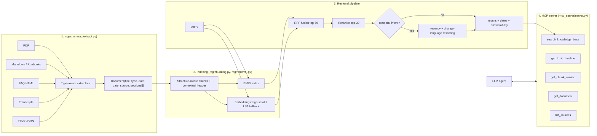

# Architecture: Engineering Knowledge Assistant (RAG + MCP)

## 1. Goal and constraints

Engineers ask questions whose answers are scattered across six document types, and sources contradict each other over time. An AI agent must find answers **using only an MCP server**: no pre-loaded context. The design follows from three constraints:

1. **Messy, heterogeneous input.** Each source type has its own noise (PDF headers, transcript filler, Slack threads without context), so extraction must be type-aware.
2. **Time matters.** "Does payment use Redis?" has a different answer in 2024 and 2025. The system must keep dates and expose them, never silently merge or hide conflicting sources.
3. **An agent, not a human, is the consumer.** Tool design (what each tool returns, what its description says) determines whether the agent can make good decisions.

## 2. System overview

## 3. Ingestion: why type-aware extraction

Everything is normalised into one model: `Document(doc_id, source_type, title, date, date_source, sections[])`, where each `Section` has a heading path and clean text. Per-type decisions:

| Source | Noise it has | What the extractor does | Date source |
|---|---|---|---|
| PDF (architecture) | running header/footer on every page, page numbers, table of contents, hyphenated line wraps | detects repeated lines by **(text, font size)** across ≥50% of pages; drops ToC/page-number patterns; uses font size to detect headings; rejoins hyphen-wrapped words | "Document date:" line |
| Markdown / runbooks | front-matter, markdown syntax | parses front-matter, splits on heading hierarchy keeping the full heading path ("Payment Service Runbook > Session issues") | `last_updated` front-matter; **missing in some runbooks → `unknown`** |
| FAQ (HTML) | nav bar, footer, scripts | HTML parser that skips boilerplate elements; every Q&A pair becomes one atomic section | `<meta name="last-updated">` |
| Transcripts | speaker turns, timestamps, "um/uh", `[crosstalk]`, small talk | parses turns, strips disfluencies, drops pure small talk, groups 8 substantive turns per section with time range + speakers | header `Date:` or "Recorded on 12 Feb 2025" (two formats handled) |
| Slack export | user IDs, emoji codes, replies without context, low-signal messages ("+1", "ack") | groups messages **by thread**, resolves `<@U123>` to names, removes emoji codes and low-signal replies, renders replies under their parent so "yeah that's the one" keeps its context | message timestamp / file date |

`date_source` records *how* we know the date (`explicit`, `inferred` from filename, or `unknown`). Undated documents are not guessed; they are flagged, because an undated runbook is exactly the kind of source that silently goes stale (the payment runbook still says Redis).

## 4. Chunking

**Default: structure-aware chunking.** One chunk per logical unit (PDF/markdown section, FAQ pair, Slack thread, transcript turn group); long units are split on sentence boundaries at ~220 words, and tiny units (<30 words) are merged with their neighbour (except FAQ pairs, which stay atomic).

**Contextual header.** Every chunk's indexed text is prefixed with `[title | type | date] heading path`. A runbook paragraph that says "check memory usage and evictions" never names its service; the header adds "Payment Service Runbook", which makes it retrievable by service name and lets the reranker see the date.

Alternatives implemented and measured (E2/E4): fixed-size windows (200 words, 40 overlap), semantic chunking (split at drops in adjacent-sentence similarity), and hierarchical small-to-big (60-word children indexed, ~400-word parent returned). Results were close (within one or two questions per category); structure-aware was kept as the default because it aligns chunks with how authors organised the content, produces clean citations (one chunk = one section), and has 40% fewer chunks than hierarchical. Hierarchical is a one-flag switch (`--chunking hierarchical`) and was marginally better on sparse facts.

## 5. Retrieval pipeline

1. **BM25** over tokenised chunk text. The tokenizer keeps compound identifiers whole *and* split (`payment-service-prod` → `payment-service-prod`, `payment`, `service`, `prod`) so exact identifiers and partial words both match. This matters because engineering questions are full of identifiers.
2. **Dense retrieval**: cosine similarity over normalised embeddings. Default `BAAI/bge-small-en-v1.5` (with its query instruction prefix); offline fallback is LSA (TF-IDF + SVD, 256 dims) so the system runs without any model download.
3. **Reciprocal Rank Fusion** (k=60) of the top-50 from each. RRF uses ranks, not raw scores, so BM25 and cosine scores do not need calibration against each other.
4. **Reranking** of the fused top-30: cross-encoder `BAAI/bge-reranker-base` when available; otherwise a feature-based reranker scoring idf-weighted term coverage of the chunk, of its best sentence and of its heading, blended with the fused prior.
5. **Temporal stage** (only when the query has temporal intent: "currently", "now", "still", "anymore", ...): `score' = relevance × (1 + 1.0·recency + 0.3·change_language) − 0.1·undated`. *Recency* is the chunk date normalised over the corpus date range; *change language* ("stopped", "migrated", "no longer", "decommissioned", "raised") marks statements that update an earlier state. Multiplicative, so recency only reorders already-relevant chunks.
6. **Answerability**: the idf-weighted share of the query's content terms that appear in the top-3 chunks. Terms that exist nowhere in the corpus get maximum idf, so a question about "SIEM" or "GPU instances" scores low. It is returned to the agent as a hint (`high/medium/low`), not used to suppress results.

At ~600 chunks, exact brute-force cosine search takes milliseconds (p50 end-to-end latency ≈ 5 ms including reranking with the heuristic reranker). An ANN index or vector database would add an operational dependency with no benefit at this scale; the `Index` class is the single place to swap in LanceDB/Qdrant if the corpus grows by 100×.

## 6. Handling conflicting and outdated information

This is the core of the "Does payment currently use Redis?" problem. Three mechanisms work together:

1. **Metadata survives to the agent.** Every result carries `date`, `date_source` and `source_type`, and undated results carry an explicit `freshness_warning`.
2. **Ranking favours current evidence on current-state questions** (temporal stage above). Measured effect: the up-to-date document ranks above every stale one in 12/15 temporal questions, vs 2/15 without it.
3. **`get_topic_timeline` makes the conflict visible instead of hiding it.** It returns all clearly relevant statements ordered by date, undated last. The agent can then answer: *"No. Redis was dropped in February 2025 (Payments Architecture Sync, 2025-02-12); the architecture PDF (2024-01) and the undated runbook still say Redis and are outdated."*

We deliberately do **not** delete or down-weight stale documents globally: historical questions ("what did we use before?") need them, and the agent should be able to explain *why* it trusts one source over another.

## 7. MCP server design

| Tool | Why it exists | Agent decision it supports |
|---|---|---|
| `search_knowledge_base(query, top_k, source_types, after, before, service)` | main entry point; returns ranked chunks with metadata, `answerability` and `guidance` | what to search, how many results, which source types (runbooks for procedures, Slack/transcripts for recent decisions), whether to retry |
| `get_topic_timeline(topic)` | resolve contradictions | "which statement is current?" |
| `get_chunk_context(chunk_id, window)` | expand a hit with neighbouring chunks | "this Slack reply / transcript turn needs context" |
| `get_document(doc_id)` | read a whole short doc (runbook, FAQ) | "I need the full procedure" |
| `list_sources(source_type)` | catalogue: counts, date ranges, doc list | orientation; find a runbook by name |

Design principles:
- **Tool descriptions are prompts.** They tell the agent when to use each tool and how to interpret outputs (e.g. "prefer the newest explicit statement", "low answerability after 1–2 rephrasings means the KB doesn't contain it").
- **Return evidence, not answers.** The server never synthesises an answer; the agent reasons over cited evidence, so every claim is traceable to a `doc_id` and date.
- **Dynamic `guidance` field.** Short, situation-specific hints (temporal question detected; undated sources present; evidence spans 2024-01 to 2025-02) nudge the agent at the moment it needs them.
- **stdio transport, stdout reserved for the protocol** (all diagnostics go to stderr). Runs locally with `python -m mcp_server.server`; works with Claude Desktop or any MCP client.

## 8. Evaluation design

- **90 questions, 15 per category** (direct, semantic, temporal/conflicting, multi-document, sparse, no-answer), generated from the same facts table that generated the corpus, so ground truth cannot drift from the documents. `tests/test_pipeline.py` verifies every relevant doc exists, every answer keyword is present in its relevant doc, and every "current" doc is newer than its "stale" docs.
- **Relevance groups**: a question lists groups of acceptable docs (a fact may appear in several docs); multi-doc questions have one group per required fact, so Hit@5 is the fraction of required facts covered.
- **Metrics**: Hit@5, MRR, nDCG@10 (doc-level), **Evid@5** (are the answer keywords actually in the retrieved text?), **CurFirst** (temporal: current doc ranks above all stale docs, within top-5), **Abstain / False-abstain** (no-answer handling), latency.
- **End-to-end answers** (`eval/answer_eval.py`): the LLM agent answers each question through MCP, and an LLM judge grades correct/partial/incorrect, explicitly penalising outdated values stated as current.

## 9. Known limitations

- **Corpus is synthetic** (167 docs, ≈63K tokens after cleaning, generated by `scripts/generate_dataset.py`), smaller than the 500K-token target; `--scale N` multiplies noise documents. When the real dataset is provided, point `--raw` at it; extractors may need small format adjustments.
- **Experiments were run with offline fallbacks** (LSA embeddings, heuristic reranker) because the build environment had no model-download access. Installing `sentence-transformers` switches to bge-small + bge-reranker automatically; re-run `make experiments` for final numbers. Expect the semantic category to improve most.
- **Temporal-intent detection is a regex.** It misses implicit current-state questions ("Which DB does profile use?" asked with no time word). Mitigation: the agent can always call `get_topic_timeline`.
- **Conflict detection is not statement-level.** The system surfaces and orders evidence; it does not extract "X uses Y" triples to detect contradictions automatically. That is the next step (see Problem 2's relationship work).
